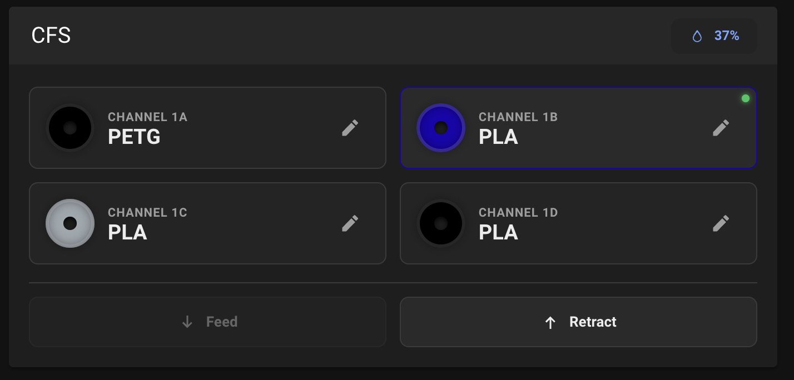

# K1C CFS Mainsail Integration (CFS-C / Next-Gen Patch)


## ✨ K1 2025 (CFS-C & Spool Holder) Fork Enhancements (@hmsGhostship)
* **5-State Filament & Buffer Logic:** Accurate real-time state handling across `Empty`, `Loaded in Hub`, `Loaded to Extruder`, `Spool Holder Active`, and `Printing / Feeding`.
* **Automatic Material & Purge Temperature Sync:** Pulls active material temperatures (`extrude_temp` / `nozzle_temperature`) directly from the selected CFS-C slot or Spool Holder profile for load, unload, and purge operations.
* **Spool Holder Mode (Non-CFS / Fallback):** Dedicated spool holder slot support when printing without CFS-C or using the external spool holder alongside CFS-C.
* **Hardware & Sensor Detection:** Live integration with toolhead filament sensors (DXC / extruder) and FLY-LLL Plus buffer/safety sensors.

> ℹ️ **Fork Note:** This is a fork of the original repository [HimAndRobot/creality-cfs-mainsail-integration](https://github.com).  
> This specific repository includes a critical frontend patch by **@hmsGhostship** to add full compatibility with newer 2025/2026 Creality printer revisions (using `nexusp` and the modern hardware architecture) where the legacy port `9999` socket is missing.

---

This project integrates a simple, compact CFS panel directly inside the **Mainsail** or **Fluidd** interface on the Creality K1C.



---

## 🚀 Features

| Category | Supported Functions |
| :--- | :--- |
| **Monitoring** | View all four CFS channels, filament types, humidity levels, and enclosure/spool temperatures |
| **Control** | Trigger `Feed`, `Switch`, and `Retract` actions directly from the web panel |
| **Configuration** | Edit filament details and customize change/purge temperatures for each material type |
| **UI/UX** | Responsive panel loader with built-in button lockouts and loading indicators during printer-side actions |
| **Mobile App** | Includes a mobile application to register multiple printers, manage filaments, and capture spool colors via camera |

---

## 📋 Requirements

Before installing, ensure your printer meets the following prerequisites:
* **Root access** is enabled on the machine.
* **Creality Helper Script** (Guilouz) is installed.
* **Mainsail** and/or **Fluidd** frontend is installed and fully functional.

---

## 🛠️ Installation

Connect to your printer via SSH and execute the following commands:

```sh
git clone https://github.com/hmsGhostship/creality-cfs-mainsail-integration.git /usr/data/creality-cfs-mainsail-integration
cd /usr/data/creality-cfs-mainsail-integration
chmod +x ./menu.sh
./menu.sh
```

**Inside the script menu:**
1. Press `1` for **Install**.
2. Choose your frontend: `Mainsail`, `Fluidd`, or `Both`.
3. Wait for the installation script to finish, then press `Enter`.
4. Refresh your selected web interface in your browser.

---

## ⚠️ Compatibility Note (Creality K1 2025 / K1C 2025)
* **Tested Firmware:** Creality Firmware **`1.1.0.27`** (K1 2025 Series).
* **Architecture Difference:** Unlike older pre-2025 K1 models (which used `/usr/bin/web-server` on port `9999`), 2025 models communicate via **`nexusp` (`CS56nexusp_service`)** and Klipper `box.cfg`—and also work without a CFS-C unit in **Spool Holder Mode**.
* **Recommended Installation:** Use the full [Creality Helper Script 2025 (CFS-C)](https://github.com/hmsGhostship/Creality-Helper-Script-2025) for one-click installation, backup/restore, and hardware sensor integration.


## 🔄 Updates & Removal

### Updating the Integration
To grab the latest features or frontend patches, simply run the script menu again:
```sh
cd /usr/data/creality-cfs-mainsail-integration
./menu.sh
```
1. Press `4` for **Update**.
2. Select your frontend choice (`Mainsail`, `Fluidd`, or `Both`).
3. The script will perform a fast-forward `git pull`, overwrite the injected web assets, and update the Klipper extension files while leaving your current CFS service state untouched.

### Removing the Integration
If you wish to cleanly revert all web interfaces to their original state:
1. Open the script menu and press `2` for **Remove**.
2. The script will safely detach the injected interface code. If option `3` was previously used to enable the legacy Creality CFS socket helper, it will automatically shut it down to preserve system resources.

---

## 📱 Mobile App (Optional)

The repository packages an Expo-based smartphone application located inside the `app/` directory.

**App Features:**
* Add and monitor multiple printers by custom labels and IP addresses.
* Establish direct, real-time WebSocket communication with your printer.
* Select spool colors manually or capture them accurately using your phone's camera.

**Running the App:**
```sh
cd /usr/data/creality-cfs-mainsail-integration/app
npm install
npm start
```
Once the bundler finishes initializing, scan the generated terminal QR code using the **Expo Go** application on your smartphone.

---

*Disclaimer: This software is provided "as is" without warranty of any kind. Use it at your own risk.*
